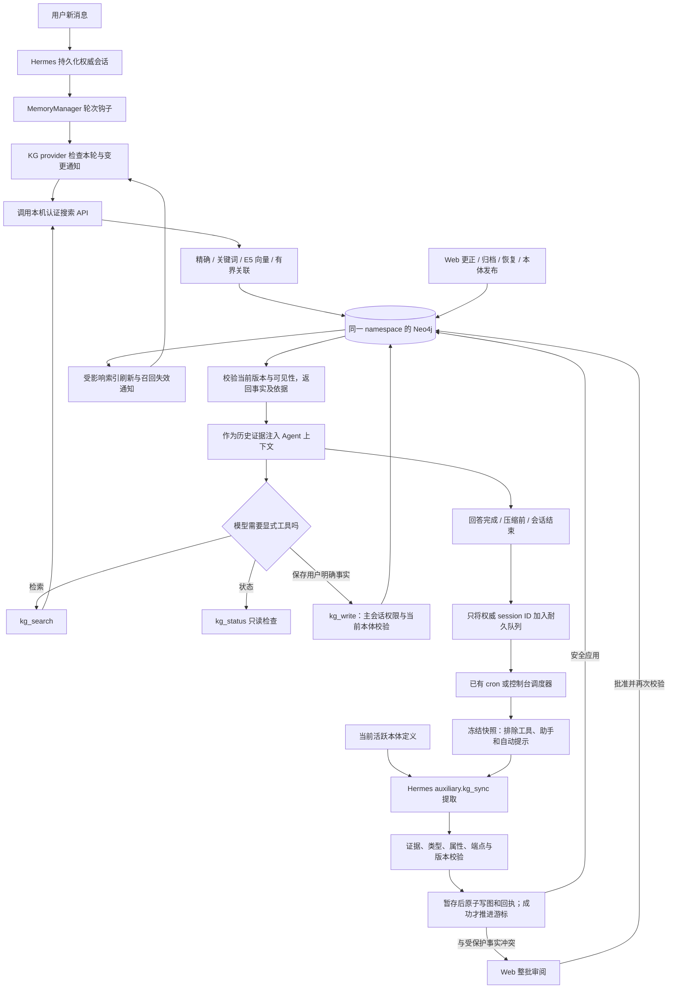

# 本机部署、升级与日常使用

此入口把 KG 部署到已有的 Hermes profile，初次安装和旧版本升级使用同一命令。它不会重装 Hermes 或 Neo4j。

## 部署前准备

| 前提 | 用户需要确认 |
| --- | --- |
| Hermes | 已完成 Hermes 安装、目标 profile 和模型路由配置；部署会通过官方入口重启该 profile 的网关，先结束正在执行的交互。 |
| Neo4j | 已启动且可通过 Bolt 连接；部署账号能读写目标数据库，并能创建所需约束和搜索索引。本轮验证使用 Neo4j 5.26 Community，不代表任意版本兼容。 |
| 源码部署工具 | Python 3.11+、满足 `console/package.json` 的 Node.js/npm（例如 22.12 及以上的 22.x）、`uv` 可用。`uv` 也可放在 profile 的 `bin` 目录。全量源码检出应包含锁文件、`console/`、`plugins/`、`skills/` 和 `scripts/`。 |
| 下载与空间 | 首次构建需要获取 npm 包、锁定的 Python 依赖、托管 Python 和本地 E5 模型；准备可访问这些来源的网络及足够磁盘空间。已有有效运行环境和模型缓存会复用，未验证无缓存的全离线首装。 |
| 路径与权限 | 源码目录与目标 profile 必须分开，不能互相包含。当前用户需有写入 profile、启动本机服务的权限；启用 Windows 登录自启动时还需写入其本人的 Startup 目录。 |

自动抽取调用 Hermes 已配置的模型，可能产生该路由的正常调用费用。构建、索引和只读健康检查本身不调用外部大模型；本地语义检索使用 E5。部署不会替用户安装或启动 Neo4j。

## 用户需要做什么

1. 先完成 Hermes 自身的安装与模型配置，准备可连接的 Neo4j。源码部署机还需 Python 3.11+、Node.js/npm、`uv` 和网络；Hermes 安装目录的 `bin/uv` 也会自动识别。
2. 在本项目源码目录运行以下命令。Windows 默认 Hermes 安装位置示例：

   ```powershell
   python scripts/deploy.py --home "$env:LOCALAPPDATA\hermes"
   ```

   macOS/Linux 的 profile 参数示例为 `--home ~/.hermes`；本轮实际安装和服务迁移验证在 Windows 上完成，不把该示例当作其他系统的实机验收。自定义 profile 使用其实际绝对路径。升级时先让源码目录包含要部署的新版本，再执行同一命令。
3. 初次安装按提示填写 Neo4j 地址、用户名、数据库和密码；密码输入隐藏，不写在命令行。已有 `kg.json` 的升级保留连接、namespace、用户身份和共享设置。首次部署会下载锁定运行依赖和语义模型；已有可用缓存会复用。
4. 命令返回 `ok:true, complete:true` 后打开 `http://127.0.0.1:8765`（自定义端口以 `kg.json` 的 `console_url` 为准）。首次连接把 `<Hermes profile>/kg-console.token` 内容粘贴到页面的连接框；若显式使用 `KG_CONSOLE_TOKEN`，则使用自己设置的有效令牌。令牌只用于本机认证，请勿发送到聊天或代码仓库。
5. 之后正常使用 Hermes。Web 的更正、归档、恢复和批准无需重启服务；修改代码或升级发行文件时才重新运行部署命令。浏览器若保留着升级前的页面，请刷新一次以加载新界面。

部署会设置 `memory.provider: kg`，通常不需要再手工编辑 `config.yaml`。若 Hermes 的目录或解释器无法自动识别，增加 `--core '<Hermes core目录>' --hermes-python '<已安装Hermes解释器>'`，不要填写本项目临时开发环境来替代宿主解释器。初次安装也可用 `--name` 指定自己的显示名；升级不会据此重建已有身份。

本机既有、可精确验证的 KG 登录自启动项会迁移到新运行环境。只识别 `Hermes_KG_Console.vbs` 中匹配当前 profile 的已知旧启动命令或已管理命令；其他 profile、未知脚本、`Hermes_Gateway_*` 和 AgentComm 项不被改写。全新安装若要在 Windows **用户登录时**自动启动控制台，可显式选择：

```powershell
python scripts/deploy.py --home "$env:LOCALAPPDATA\hermes" --autostart
```

这不是 Windows 系统服务，也不负责 Hermes 网关自身的登录自启动。未设置 KG 登录自启动时，关闭浏览器不会停服务；重启电脑后运行已安装入口即可启动，无需重新构建：

```powershell
python '<Hermes profile>/scripts/kg_service.py' start
```

该入口可由任意 Python 3.11+ 引导，自动读取 `<profile>/kg-deploy/manifest.json`、核对安装文件和独立运行环境，再选择真正运行服务的解释器，不需要手改锁哈希。同一发行版本已运行时只做认证健康探测，不重复启动；未知监听者或正在恢复的部署会被拒绝，不按磁盘上的 PID 盲杀进程。需要时也可以再次运行完整部署命令。macOS/Linux 的登录/开机服务不由此版本自动创建，实际 OS 重启或重新登录另列为未测。

旧的模型缓存目录会按已配置的运行设置复用。移动或删除该缓存前，应重新准备模型并更新运行设置；不能把模型目录误当作可随意清理的源码构建产物。

代码和 Python runtime 独立于 checkout，不等于显式配置的模型缓存也已自动搬迁。若旧 `model_cache` 位于源码目录，语义模型仍依赖该目录；移走 checkout 前先将模型缓存迁至稳定位置，保留其余设置并更新 `<profile>/kg-console-runtime.json` 的 `model_cache`，再运行完整部署命令重新验证语义就绪。

## 可选参数与本地文件

| 参数 | 含义与边界 |
| --- | --- |
| `--dry-run` | 只展示部署步骤，不构建、不改配置、不启停服务。 |
| `--non-interactive` | 不询问新装凭据；需由当前进程的安全环境提供 `KG_PASSWORD`，可另设 `KG_BOLT_URL`、`KG_USER`、`KG_DATABASE`。不要把密码写入命令行参数或文档。 |
| `--port` | 新装可选择 1024–65535 的本机端口；已有 profile 的端口必须与其 `console_url` 一致，冲突时拒绝部署。 |
| `--core`、`--hermes-python` | 显式指定已安装 Hermes core 和宿主解释器；KG 控制台自身仍使用锁文件创建的独立 runtime。 |
| `--autostart` | 显式添加 Windows 当前用户登录项；已有可验证的 KG 项无需重复选择就会迁移。与 `--skip-services` 不能同时使用。 |
| `--skip-model`、`--skip-services`、`--skip-restart` | 仅用于主动接受限制的部分部署，返回 `complete:false`。跳过模型不代表语义就绪，跳过服务不代表 HTTP 可用，跳过网关重启不代表现有 Agent 已加载新代码。 |

| profile 内位置 | 用途 |
| --- | --- |
| `plugins/kg/`、`skills/kg-memory*`、`scripts/kg_*.py` | 安装代码、技能、启动入口和 UI 资源；成功安装后代码与服务解释器不依赖源码 checkout 或仓库的 `.venv-console`，显式外置模型缓存按前述规则保留。 |
| `kg-runtime/` | 与 Hermes 分离的锁定 Python 3.11 及控制台依赖；由 manifest 选择，不能只复制其中某个 Python 可执行文件。 |
| `kg.json`、`config.yaml`、`kg-console.token` | 连接/身份、Hermes provider 配置和认证令牌，可能含敏感内容。 |
| `state.db`、`kg-sync/` | Hermes 权威会话来源、耐久同步状态、任务、召回失效标记等本地状态，不属于发行文件。 |
| `kg-deploy/manifest.json`、`last-result.json` | 已安装文件/资源哈希、runtime 选择及最近部署结果。 |
| `kg-deploy/backups/`、`transaction.json` | 本地恢复副本与未完成事务记录；备份可含配置、令牌和旧登录脚本，保留在私有目录，不提交 Git。 |

无需执行旧的 `scripts/install.py` 再执行完整部署；旧入口只复制插件及部分依赖，不替代构建 UI、服务迁移、宿主重启与验收。

## 部署命令完成哪些操作

部署会构建 UI，建立与 Hermes 依赖分离的锁定 Python 3.11 环境，完整暂存 provider、技能、运行脚本和静态资源。通过预检后才切换版本；已删除的旧代码和旧 bundle 不会混入新版本。已有 profile 配置、令牌、会话数据库和同步进度不作为发行文件覆盖。

切换期间持有相同的同步 runner 锁，防止 cron 与代码替换并发。耐久的待扫描会话和失败快照保留，不要求先调用模型处理历史内容。已有正在执行的任务会阻止不安全的旧服务迁移。

代码启用后，命令检查数据库、本体/索引、语义模型、认证 API、前端文件哈希，再通过 Hermes 官方入口重启目标网关。只有 OS 进程身份确实更新、运行状态新鲜，并且宿主实际 MemoryManager 可以加载已安装 provider、执行只读连接检查时，才报告完整成功。

运行记录位于 `<profile>/kg-deploy/last-result.json`，文件清单位于 `manifest.json`。它们区分 Git 提交、工作区是否有修改和实际发行内容哈希，不把未提交的本地源码冒充既有 GitHub 发行版。

## Web 修改何时生效

| 操作 | 下次 Agent 使用的行为 |
| --- | --- |
| 更正、恢复、批准事实 | 数据库先提交；语义模型已就绪时同步刷新受影响记录的关键词/向量索引，再发送跨进程召回失效通知。下一次搜索或召回读取新版本。 |
| 归档 | 正常读路径立即排除，旧 chunk 和最终结果仍有版本/归档校验；不会因旧索引而重新显示正文。 |
| 本体名称、属性、端点与生命周期变更 | 发布当前 namespace 的有效规则。下一次写入、自动抽取及审阅校验使用当前规则；停用保留历史读取，不等于删除事实。 |
| 新类型、新属性或新关系 | 活跃定义进入下一次抽取的结构化规则数据；仍需原文证据，不能由本体描述覆盖提取安全规则。 |
| 手工更正与自动抽取冲突 | 形成整批候选，等待 Web 审阅；自动抽取不会覆盖受保护的人工更正。 |
| 暂停/恢复同步 | 控制后台抽取任务，不关闭已有记忆的搜索。已有外部 cron 的升级继续保留原调度归属，避免重复调度。 |

已开始生成的回答不会追溯重写。若语义刷新失败，写入成功回执仍保留，并明确返回检索降级/待索引状态；不能把“保存成功”误报成“向量索引已完成”。正常完整部署会先验证语义模型就绪。

这里的“下次使用”指提交成功后的下一次实际检索或符合条件的召回：同一轮同一查询也会核对失效标记，收到通知后允许一次越过普通召回间隔。短寒暄、次级/自动会话及不需要记忆的轮次不会被强制注入；模型已看到的历史上下文不会被事后删改。新旧描述冲突时，应以一次新的 `kg_search` 结果核对，不能保证模型在没有查询时主动更正之前的回答。

本体改名改变的是定义说明，不会改写每条既有事实的名称。类型停用保留历史身份和读取，限制后续新增使用；删除只允许无引用的自定义定义。发布恰好发生在抽取中时，抽取会重新核对版本并进行有界重试；已暂存的历史 payload 不会被静默改写。审阅仍可显式修正新规则要求的字段，最终写入再次校验当前规则。

Web 中已提交的更正与“刚聊过的新事实”是两种时机。普通对话结束时只排入权威 session ID，后台同步任务随后才抽取和提交；控制台默认检查调度状态并约每四小时发起同步，既有 Hermes cron 则保留其调度归属。需要提前处理时使用 Web 的“运行同步”；失败会保留快照/进度以便重试，待审候选不能当作已保存事实。首次接入不会偷偷回填全部历史；历史回填需显式选择。

## Agent 集成流程



`kg_status` 不写测试事实。自动抽取使用 Hermes 配置的模型路由，不上传图给外部渲染服务；只有需要提取的真实用户正文及必要定义规则进入已配置的模型。历史回填需要显式选择，不由升级命令偷偷触发。

## 故障与恢复

- `--dry-run` 只展示步骤。`--skip-model`、`--skip-services`、`--skip-restart` 明确标为部分部署，不代表全功能验收。
- 现有连接与 namespace 若被冲突的环境变量覆盖，部署拒绝继续，避免操作错空间。清除冲突覆盖后重试；不要为绕过检查改个人 URI。
- 旧控制台忙碌或端口属于未知进程时，部署先失败，不按端口盲杀。等待本项目任务完成后重试。
- 普通失败会恢复旧 payload 与配置，并恢复受管理的原服务。已成功的幂等数据库 schema/index 创建不会反向删除。
- 首次安装失败后，已生成的 namespace/用户身份和历史接入边界会保留，配置可能被置为未启用并留下 `pending-install.json`，用于安全重试；不要删掉它们后当作全新空间重装。配置或 Startup 被别人同时修改时保留其内容并报告需人工恢复，不用旧备份强行覆盖并发编辑。
- OS 强制中断会保留 `kg-deploy/transaction.json` 与对应备份并阻止混版重试。保留该目录，先按备份恢复；不要直接删 journal 冒充成功。
- 备份可能含连接配置和访问令牌，只能保存在私有本地目录。记忆备份/恢复仍使用原来的 namespace 范围维护入口。

## 可重复验收

使用隔离 Neo4j 和已准备 E5 缓存跑完整 `scripts/run_tests.py`，前端运行 `npm test` 与 `npm run build`。安装后还可运行 `scripts/verify_deployment.py`：它从实际安装目录加载代码，在临时 profile 与随机 namespace 中启动真实 HTTP 服务，验证 Web→Agent 生效并清理夹具。

该脚本要求 `KG_TEST_BOLT_URL`、`KG_TEST_PASSWORD` 指向可丢弃测试实例，`--home` 指向已安装 profile，`--model-cache` 指向已准备缓存，`--output` 写入忽略的报告目录。只有显式 `--real-agent --host-python <宿主解释器>` 才运行真实模型的合成 Agent 会话；真实 profile 仅提供模型路由，不发送个人历史对话或记忆。它会创建/清理自己的合成夹具，是开发验收工具，不是用户每次使用前的必做步骤。

本轮证据、性能目标和未实测范围见 [部署验收记录](deployment-validation.md)；已有图交互的设备与样本范围另见 [Graph v3 验证记录](graph-v3-validation.md)。
