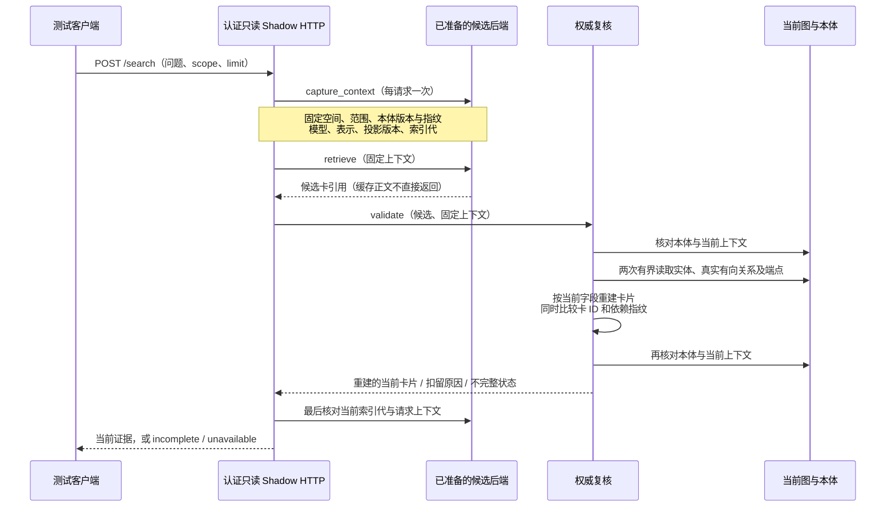

# 检索候选的在线复核与隔离测试

本文描述研究中的接入边界。当前生产默认仍使用 E5-small；这里的模块没有自动替换生产检索、
创建生产索引或切换模型。充分证据、无答案判断和正式选型仍须通过冻结协议。

## 一次请求如何读取当前知识

`retrieval_authority.py` 批量读取的默认上限为100个候选、200个来源和500条实际关系。
只使用固定、参数化的只读查询。超预算不截断后宣称完整，数据库错误不解释为“没有答案”。
节点查找沿用 canonical 优先规则；存在不可见 canonical 时，不回退到同 URI 的可见 legacy。
profile 范围要求每个事实来源属于当前空间；shared 范围仍须重新核对共享状态。

实体卡重新读取当前属性；关系卡必须重新读取真实存储的有向边及双方端点，保留自环、反向
关系、不同限定词及重复计数。只比较逻辑三元组不足以验证具体关系断言。端点改名即使没有
增加 revision，也会改变关系卡内容身份。本体卡重新读取定义并明确标为规则。

缓存中的文字、`is_rule`、来源说明和其他 metadata 不直接作为输出。匹配通过后只返回
重新构建的卡片。归档、停用、共享撤销、删除、字段或限定词变更使旧候选被扣留；恢复后的
当前版本需要重新投影，不能因为同 URI 再次可见就忽略依赖变更。

## 一致性的实际边界

`RequestContext` 不可变；本体读取后复制，避免其他请求修改共享字典。当前上下文在复核前、
重建后及 HTTP 返回前分别校验，观察到模型、表示、投影版本、本体或索引代变化时扣留全部结果。
两次来源读取比较完整属性和关系变体，不只依赖 revision 字段。

Neo4j 使用 read committed。这些检查证明观察到的读取边界一致，不提供串行化事务或持续
授权租约；最后检查之后发生的新写入不能撤回已经发出的响应。新索引的构建追平、原子发布、
崩溃恢复与生产并发发布仍须另外实现和验收。卡片当前有效也不证明它能回答用户的问题，
更不证明充分证据齐备。

## HTTP 边界与结果语义

`retrieval_shadow.py` 仅提供认证的 `POST /search` 和 `GET /status`。应用不读取默认 profile、
下载模型或创建索引；调用者显式注入已准备的后端和权威复核器。它不暴露工作台的审核、
更正、同步或模型管理路由。`interpret`、额外字段和任意查询计划会被拒绝。

| 状态 | 含义 |
|---|---|
| found | 候选的当前来源复核通过；不代表答案充分 |
| empty | 本次候选为空；不证明全库不存在答案 |
| incomplete | 部分来源失效、不可见或请求上下文发生变化 |
| unavailable | 数据库或检索不可用；HTTP 503，不能作为无答案样本 |

所有响应禁用缓存。认证失败先于路由和请求校验，错误不回显问题、URI、令牌或数据库异常。
规则与事实分开标注，状态接口只返回允许的运行字段。

## 验收与证据级别

单元测试覆盖正文和端点变更、权限撤销、并发发布、读取失败、候选正文污染、平行边、
自环和反向边。真实 Neo4j 测试只写入本轮随机标记的合成夹具，结束后核验残留为0。
独立回环 HTTP harness 使用本地缓存的真实 E5 向量，不调用生成模型。

隔离 Shadow 的合成测试属于工程安全证据。它不是已部署候选路径、正式数据集或模型的
晋级证明，也不是 ANN 一致率、正式 HTTP 性能或端到端答案正确率的替代物。
具体样本数与运行结果见本轮研究报告；未执行的环节必须保持未验收。
