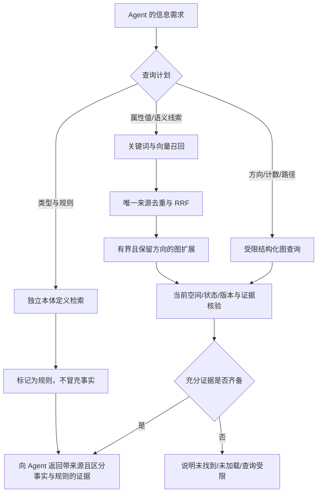

# 图结构知识检索：实验进展与决策记录

日期：2026-10-24。状态：CPU开发实验与查询修复已交付；真实gold和正式模型选型待完成。

## 当前结论

已在本机真实运行 E5-small、E5-base、Qwen3-Embedding-0.6B 和 BGE-M3 dense，
权重固定到完整 commit SHA。不是用随机向量或模型排行榜代替项目实验。
开发集出现值得继续验证的质量提升，但没有配置通过完整晋级条件。
现有 Hermes 默认 embedding 和 MiniMax 抽取模型没有切换。

主要缺口是：真实 gold 待人工锁定；无答案误注入率未达标；盲测尚未运行；
新流程的完整 HTTP、安全变更和索引代切换证据尚不齐备。

## 已落地的实验与工程能力

以下研究适配层与评测工具运行在独立环境；查询性能修复和结构化只读工具已部署本机 Hermes。

- 可复现的依赖锁、固定权重、设备/精度/线程记录、文件哈希、向量缓存及隔离研究索引。
- values、带字段与类型的实体卡、实体加有向关系卡三种表示；本体定义独立检索。
- 精确 cosine、离线 BM25、RRF 混合及有界有向图扩展消融工具。
- Neo4j ANN 与精确排序对照，可在过采样候选上重算 cosine；不同实验索引隔离并清理。
- schema / relations / count / path 的受限结构化查询计划与 HTTP/provider 通路。
  不执行任意 Cypher；规则证据与事实证据分离；结构化失败不静默退回普通文本搜索。
- 私有只读快照、100 条人工标注工作台、充分证据集合、来源家族隔离及不可覆盖的锁定。
- 报告核验 manifest、配置、结果和代码指纹；两个比较组均校验；缺少证据时禁止晋级。
- 在线权威复核与隔离只读 Shadow HTTP；每个请求固定上下文，只返回按当前来源重建的卡片。
- 只读 readiness 汇总与受120次总预算保护的端到端回放执行器；默认离线预检，不自动签署人工评分。

新投影目前是实验适配层。它还不是已上线的新索引代管理器；现有生产检索不应被描述成
已经获得全部新卡片、原子索引切换或新模型能力。

## 首轮精确向量结果

数据为 60 条 authored synthetic 开发题，来自 6 个独立来源家族；其中 12 条真正无答案、
6 条计数/聚合题。下表采用排除聚合的 `selection_facts`，主指标按来源家族宏平均。
真实人工 gold 为 0/100；未读取盲测输出。不能把合成开发集结论推广为真实业务选型。
当前比较显式采用 `scope=profile`，仅当前空间来源，关系双端均属本空间；不是默认混入
可见共享记录。语料为250张实体卡，关系表示另加200张关系卡（后续按唯一证据计分）。

| 模型 | 表示 | nDCG@10 | Recall@50 |
|---|---|---:|---:|
| E5-small | values | 0.3287 | 0.8095 |
| E5-small | entity | 0.3682 | 0.7857 |
| E5-small | entity_relations | 0.3832 | 0.8095 |
| Qwen3-0.6B | values | 0.4639 | 0.8929 |
| Qwen3-0.6B | entity | 0.4480 | 0.8095 |
| Qwen3-0.6B | entity_relations | 0.4647 | 0.8333 |
| E5-base | values | 0.4549 | 0.8333 |
| E5-base | entity_relations | 0.4316 | 0.8690 |
| BGE-M3 dense | values | 0.3990 | 0.9048 |
| BGE-M3 dense | entity_relations | 0.4008 | 0.8095 |

统一 CPU float32、8 线程、512 token 上限；逐模型使用官方前缀与池化。
开发集精确查询计时记录在原始报告中；部分实验与其他 CPU 工作重叠，不能当成正式 HTTP 性能对比。

Qwen values 相对 E5-small values 的家族宏平均差值为 +0.1352，95% cluster bootstrap
区间约 [0.0534, 0.2307]；家族成对符号随机化 p=0.0295，Holm 后 p=0.2654。
E5-base values 差值 +0.1262，区间约 [0.0370, 0.2327]，Holm 后 p=0.4548。
6 个家族的独立样本很少：区间为正仍不能忽略未通过的探索性成对检验。
这里的 Holm 覆盖9个候选相对同一基线的比较；它们仍是开发集探索，不是正式盲测。
E5-base values 在多证据任务上还出现 Recall@5 从 0.5000 降至 0.4167 的回退，
超过允许下降 0.03 的门槛；整体分数提高不能掩盖这个分组。

上述十个纯向量配置在 12 条开发集无答案题上的离线接受率（FPR）均为 100%。
它测量 top-k 证据接受，不是 Agent 生成回答的误答率，也不代表尚未运行的其他流程。
开发集单分数阈值曲线显示，
Qwen values 和 E5-base values 均无法同时满足 FPR≤5% 与充分证据覆盖≥90%。
拒绝所有结果可使 FPR 为零，但覆盖也为零，不能当成修复。

这些初步结果说明：文本模板是待验证的表示假设。当前通用 Concept/description 合成题
对字段语义、数值、方向与关系限定词的覆盖不足，需要另外的图语义诊断。
不能据此宣布模板有害，也不能预设更多结构文本必然更好。

早期 `matrix-final/` 使用授权快照中的可见共享记录作为额外背景，属于另一语料条件。
其 nDCG/CI 等保留作探索性记录，不与此处纯合成 `profile` 语料混比，也不作为正式选型。
projection 的共享读取本身不是越权；研究配置必须显式表明范围。Web 默认 profile，
现有 Agent provider 普通召回显式 shared，这个差异也需在正式上线评估中覆盖。

## 消融与图语义专项

同一 `profile/values` 开发语料，固定50候选和上下文预算：

| 方法 | E5-small nDCG@10 | Qwen nDCG@10 | E5-base nDCG@10 |
|---|---:|---:|---:|
| 纯向量 | 0.3287 | 0.4639 | 0.4549 |
| 离线BM25 | 0.1687 | 同一无模型基线 | 同一无模型基线 |
| 等权RRF | 0.2371 | 0.3385 | 0.3291 |
| RRF+有向一跳 | 0.2371 | 0.3385 | 0.3291 |

这个合成语料中无条件融合拉低排序，邻域扩展也没有改善前排；不能把“混合+图”预设为更优。
离线BM25不是生产Neo4j Lucene的复现。路径、计数及限定关系仍应另用结构化执行器评测，
不能由此表判断其任务成功率。本轮所有流程的Recall@50均未达95%，未触发重排模型试验。

另有54题/9家族的预先冻结图语义诊断，小语料12实体、有向关系表示另8卡、规则18卡：

| 开发诊断 | E5-small | Qwen3-0.6B |
|---|---:|---:|
| 无实体名属性组合查询，values→entity | 5/6→6/6 | 4/6→6/6 |
| 有向关系充分证据进入top5 | 8/8 | 7/8 |
| schema检索 | 6/6 | 6/6 |

Qwen漏掉一次自环关系卡。字段可读证据从0/16变为16/16主要是渲染曝光对照，不能解释为
模型理解或回答正确率；19个结构/缺失任务的回答正确率为N/A，4个无答案问题均仍返回候选。
IRI目标命中也不证明IRI字面值能从卡片读出。本专项支持保留结构语义，但样本很小、没有显著性结论。

独立本体开发集20题，两模型均 nDCG@10=1；另运行36项开发集静态安全检索，禁止来源命中为0。
其余40题本体与84项安全盲集未提前运行。静态结果不能证明在线权限变更、修订竞态或恢复事务安全。

## ANN 范围与候选池

同250张本空间卡、1000条真实独立编码的外空间背景、60个开发查询：全局ANN索引的
Top50对预过滤exact参照一致率仅86.4%；过采样后重算cosine也仅约88.5%。
重算不能补回已被外空间近邻占用的候选。因此原型改为按空间、模型与运行代隔离索引，
再重算cosine并合并同卡chunk。该250卡范围恢复100%，但候选预算已覆盖全分区，不能外推大索引。

进一步真实生成10000条不同本空间文本/向量，连同250卡及1000条外空间向量共11250条；
分区索引实际包含10250条，60查询Top50一致率100%，候选预算500，没有枚举全分区。
所有随机索引与节点清理后剩余0。ANN阶段p95约20.5ms、Python exact参照约708.9ms，
仅作实现诊断（有CPU争用，且不含query编码/HTTP/权威数据核验），不能当作完整检索p95。
Python exact只是参照实现，不能据此声称相对优化向量库或数据库exact也有同等速度优势。

万级增强语料标记 `synthetic_scale_diagnostic`，不能伪装成原250卡语料的晋级证据；
一致率也不是语义相关性或回答正确率。索引分区原型尚未启用到生产，在线权限与版本核验仍需独立验收。

## 当前 HTTP 基线发现

隔离 Neo4j 5.26（4 CPU、4GiB）使用真实 E5-small CPU 向量和实际认证 HTTP：
1k 实体、3k 关系，单请求与并发4各200次，暖机 p95 分别约380ms、471ms。
发生一次 Bolt 连接重试，最长请求约20.08s；不删除长尾，不把 p95 解释为请求耗时上限。
旧链路采用2个编码线程，本项是工程基线，不是协议要求统一8线程的候选模型对比。

10k 实体、30k 关系实际建索引：10k个独立文本及10k个不同真实向量；
编码约103.30s，总构建约125.25s。修复前单请求200次的 p50 为2.681s、p95 为11.790s、
最大11.980s；并发4另200次 p50 为2.908s、p95 为12.826s、最大13.055s，均超过3s目标。
两种规模四个窗口共800次请求完整结束，已清理本次两个研究空间的节点与chunks，剩余0。
HTTP未报错；旧工具未保留逐次响应 warnings，不能据此声称每次
都无降级。该窗口暴露 fulltext authority hydration 慢点。
仅编译的 EXPLAIN 确认：原兼容分支的 `kg_primary IS NULL` 过滤在 `AllNodesScan`
之后，已有 canonical 唯一索引命中仍可能为每条候选扫描全库。

已在源码改为 CASE-gated 空 UNWIND，5项真实小夹具测试通过，包括 canonical 路径的
PROFILE 扫描行数与 dbHits 为0；兼容旧实体、隔离、不可见 primary 不回落和 missing/null 语义保留。
这只调整查询控制流；权限、空间、当前版本核验和候选范围不能为了提速被移除。
万级修复后重测使用新进程、相同拓扑与真实独立向量、同样2编码线程与20次热身：

| 10k规模 | 样本数 | p50 | p95 | p99 | 最大值 |
|---|---:|---:|---:|---:|---:|
| 修复前并发1 | 200 | 2681ms | 11790ms | 未采集 | 11980ms |
| 修复后并发1 | 200 | 552ms | 634ms | 653ms | 859ms |
| 修复前并发4 | 200 | 2908ms | 12826ms | 未采集 | 13055ms |
| 修复后并发4 | 200 | 616ms | 712ms | 913ms | 1384ms |

修复后400次真实HTTP均无错误、无降级、无warnings，保留逐请求耗时；空间、chunks、
临时profile与服务均清理完成。旧窗口为观察慢点将DB单查询超时设为120s，新窗口恢复10s；
修复后无超时或降级，不能把超时后关键词回退冒充提速。构建时延、源码SHA、原始报告分别保留，
旧报告为 `scale-baseline-original.json`，新报告为 `scale-baseline-postfix-10k.json`。
这是一次本机工程对照，未做多轮平台统计。真正的 legacy 或缺失来源仍需扫描，
不能据此宣称所有查询都为常数时间。这仍是旧E5/旧投影基线，不替代新模型/新卡流程的HTTP晋级证据。

## 工作流设计与证据边界



上图是目标流程。当前已实现实验召回、卡片和结构化工具；语义分类器、可靠的拒答决策、
生产新卡索引与索引代切换尚未验收。普通最近邻分数不是“答案存在概率”。
计数和路径用图执行器核验，不能只看向量 top-5；本体说明允许连接，不证明连接已经发生。
当前生产普通检索的图扩展仍是一跳无向扩展；新实验的方向约束尚未替换它。
结构化计划由 Agent 显式选择，不会由现有文本改写器自动生成；路径暂不支持时间筛选。

由本轮数据支持的下一阶段流程是：先按任务区分规则、精确字段/身份、关系结构和开放语义，
结构问题直接使用受限图执行器；语义候选保留字段与类型，单列关系和规则，不把更长模板或
等权RRF当成默认收益。索引按空间/模型/代隔离，过采样后重算cosine、合并同一证据的chunk，
最后核验当前权威版本与可见性。限定词不同的平行关系不能被当成同一事实；当前主要检索指标
按实体URI/逻辑关系计分，限定词级正确性另列专项，不能用主表分数代替。

Qwen与E5-base可作为后续真实数据对照候选；现有E5仍为默认。必须在真实dev上解决充分证据
与无答案接受问题，再冻结配置做盲测；仅靠cosine阈值不够。回答继续使用原MiniMax路由核对
来源与证据，不为这次embedding研究额外增加生成模型。该拒答/核验工作流尚未完成，不能把
本节设计写成已通过端到端验收。

## 重现与人工工作

最终研究核心指纹为 `93afbf295eb252c809a2de49b2dbc0b7f91f30a589310fc6fff09b1a9c1a9a8e`。
本体划分已核对为20 dev/40 blind，同定义族不跨分组；修正没有改变事实题、真实候选或数据。
最终源码快照与逐模型结果均保留在本地报告目录。

Windows CPU 一行入口（需已安装 uv，首次允许下载固定模型）：

```powershell
python scripts/run_retrieval_research.py --output reports/retrieval-dev --allow-download
```

它只执行开发集，不读取默认 Hermes profile、不调用外部生成模型、不切换生产配置。
可用 `--resume` 继续完全匹配指纹的结果；`--offline` 禁止 Python、依赖和模型下载。
本机已实际创建隔离managed Python与CPU依赖；最终版本六组离线执行成功，严格恢复复用6/6。
它复用了先前已下载的权重，不冒充全无缓存新机器的完整下载验收。
详细命令与指标解释见 `plugins/kg/research/README.md`，冻结门槛见
`docs/retrieval-research-protocol.md`。

真实数据仅留在忽略的 `reports/retrieval-research/private/`。本次快照为 165 个实体、
84 条关系，自动排除显式测试/占位标记后生成 99 个草稿信息需求及 1 个待补充名额。
只有 6 个真实来源家族；同一来源的多个问题不应被当作独立样本。
候选仍须人工排除历史测试残留、核对关系方向和真实不可回答性。

已提供预填工作台 `reports/retrieval-research/private/preannotation-2026-10-26/human-review-prefilled.html`；
旧v2空模板页继续保留。逐项确认问题、相关性 0/1/2、充分证据集合和不可回答项，再导出 labels JSON。
不要用模型代签人工审阅。全部 100 条通过校验后才能创建锁、冻结入围配置并执行盲测。

旧工作台继续可用；导出后可在修正20/40划分的新fixture上校验，因为真实题与来源指纹未变。
新fixture为 `reports/retrieval-research/private/human-review-sealed/`；旧v2页面与草稿未被覆盖。
需要用户提供的是逐条人工复核后的labels JSON路径。尚未运行盲测或120次预算内的生成评估，
不能让时间经过或自动填表代替真实gold。

2026-10-26已完成100条机器预标注：字段支撑置信度78高、20中、2低；22条优先复核，
60条另有共同的来源归属缺失风险。建议答案、0/1/2证据、完整充分集合和疑点均已预填，
详见同目录`uncertain-items.md`。第040条补同dev活动的记录时长问题，保留派生计算与年份推断提示。
当前100条均能从快照字段作答，真正无答案题仍为0，正式冻结前须补充经人工确认的负例。
这些机器草稿不计人工gold，未创建lock或运行盲测。原始输入和93af核心指纹均未改变；
新增15项单元测试、9组真实浏览器检查通过，页面错误和外部请求均为0。

## 在线接入准备与剩余依赖

新增 `retrieval_authority.py` 不信任缓存正文：按固定请求上下文读取当前实体、真实有向边和
双端点，两次比较来源状态，重新生成卡片，同时匹配内容ID和依赖指纹。新建的
`retrieval_shadow.py` 只暴露认证的search/status，不复用仍含写路由的工作台应用。
本体、模型、表示、投影版本或索引代在请求中发生变化，会明确扣留结果。
具体流程与read committed边界见 `docs/retrieval-online-contract.md`。

新增63项集成检查全部通过：18项权威复核单元测试、7项真实Neo4j测试、22项HTTP契约、
4项合成夹具隔离守卫和12项readiness检查。独立真实E5-small/Neo4j/回环socket HTTP
安全harness另通过20/20项，涵盖召回后修改正文/端点、归档/恢复、共享撤销、删除关系、
限定词与方向变化、本体发布、索引代切换、数据库不可用和并发请求隔离。
最终源码指纹与报告一致，研究库残留节点0，临时HTTP/profile已清理，研究容器已关闭。

这些是合成工程安全验证；使用CPU2线程和内存测试publisher，不是新候选的正式性能、
已安装provider安全或生产原子索引切代证明。生产完整代注册表及构建追平仍未实现。
当前卡片通过权威复核也不证明答案充分；empty只代表本次候选为空，不证明全库无答案。

`scripts/research_readiness.py` 已实际核验10份开发模型报告完整，真实锁定数据绑定0份，
人工gold仍为0/100，盲测为0。v2表单的真实条目可导入sealed fixture；旧lock因绑定旧fixture
不能复用，须重新校验生成。它同时要求候选自己的ANN、HTTP与安全证据，不能用旧E5
性能报告证明候选关系卡流程。命令与状态说明见 `docs/research-readiness.md`。

`scripts/research_end_to_end.py` 默认只做离线预检。正式执行要求100条人工gold及新lock、
事先冻结的15真实+15合成blind任务、两臂配置和实际检索输出；固定prompt与上下文预算，
使用本机原MiniMax主路由。工作区唯一持久账本先提交额度预留再调用，未知结果消耗额度且
不自动重试；换输出路径或计划不能重置120次总预算。独立执行代码也被freeze指纹绑定。
只读真实路由探测已通过：`minimax-cn / MiniMax-M3.1-Flash`，生成请求0次。
执行器另16项定向检查通过，含真实SDK的MockTransport 500响应只尝试一次、未知槽不重发、
跨输出路径不能重置额度及按两臂/匹配任务列示人工分数。首次在沙箱系统TEMP目录受权限限制，
改用工作区`.cache`临时目录后全部通过；失败日志与最终通过日志均保留。

该执行器是“固定检索输出回放→主模型”的受控评测，不冒充实际Agent完整在线调用；
正式回放、答案与依据的人工评分仍未执行，模板中的正确率保持N/A。
收到人工labels后仍须完成真实dev校准、配置冻结、盲测和达标流程的接入验收。

## 本机部署与回退

已用既有一行入口完整升级本机 Hermes：

```powershell
python scripts/deploy.py --home "$env:LOCALAPPDATA\hermes" --non-interactive
```

结果 `ok:true, complete:true`；认证API、数据库、语义模型、静态资源及官方Gateway重启探测通过。
安装后search.py哈希与修复版本一致；未认证401，结构化schema/count只读返回正常；
普通搜索hybrid/current且无警告。连接/身份/令牌/主模型与同步队列状态核验保持一致，未增删业务事实。
研究Torch、候选embedding和ANN分区原型没有在此部署中启用。

本次代码备份ID为 `4bf4d1055f924e2197d485e786e4fa8a`，由既有部署器保留在profile的
`kg-deploy/backups/`。普通部署失败会自动恢复旧payload/配置和受管理服务；成功后的退版使用
完整旧发行重新执行同一部署入口，不通过单文件覆盖或重建业务图实现。
此轮未执行成功后退版，不能把备份存在写成已演练回退；既有恢复说明见 `docs/deployment.md`。
用户继续使用Hermes即可；已打开的Web页面刷新一次，模型选型阶段只需完成人工复核。

完整后端验收706项：705通过，1项因本机Windows符号链接权限跳过。后续研究限定变更的
37项无模型回归、ANN分区9项定向测试均通过；其中真实小PROFILE确认canonical兼容扫描dbHits为0。
人工表单另有8项真实Chromium合成UI检查，无网络请求和脚本错误。

## 已知平台限制与尚未完成

- Windows CPU 已运行；Linux/macOS、GPU 不冒充已测。
- 本机 RTX3070Ti 8GB 可用。首次检查 C 盘仅约4.3GiB空闲，无法安装 CUDA torch；
  后续只读检查已约15GiB空闲。GPU为可选项，本轮先完成CPU，没有继续下载约2.9GB
  CUDA轮子、没有安装或推理。历史 `gpu-probe.json` 记录首次空间不足，不代表当前仍不足。
- EmbeddingGemma300M 需要合法权重访问，当前记为未测；没有用其他模型替代。
- 当前纯向量 Recall@50 未达到 95% 的 reranker 触发条件，未为了增加配置而下载重排模型。
- 端到端 MiniMax 回答评估尚未开始，外部生成调用数为 0；最多 120 次的预算仍保留。
- 不存在达标的新默认版本；不应仅凭上述开发集分数部署新模型。

## 参考实现约束

E5 使用其官方 query/passage 前缀与平均池化；Qwen 使用官方查询指令与末 token 池化；
BGE-M3 本轮只比较 dense，不把 sparse/multi-vector 头混入相同实验。
来源为 [E5-base 模型卡](https://huggingface.co/intfloat/multilingual-e5-base)、
[Qwen3-Embedding 模型卡](https://huggingface.co/Qwen/Qwen3-Embedding-0.6B)、
[BGE-M3 模型卡](https://huggingface.co/BAAI/bge-m3)。模型卡排行榜只作背景，不作本项目选型证据。
